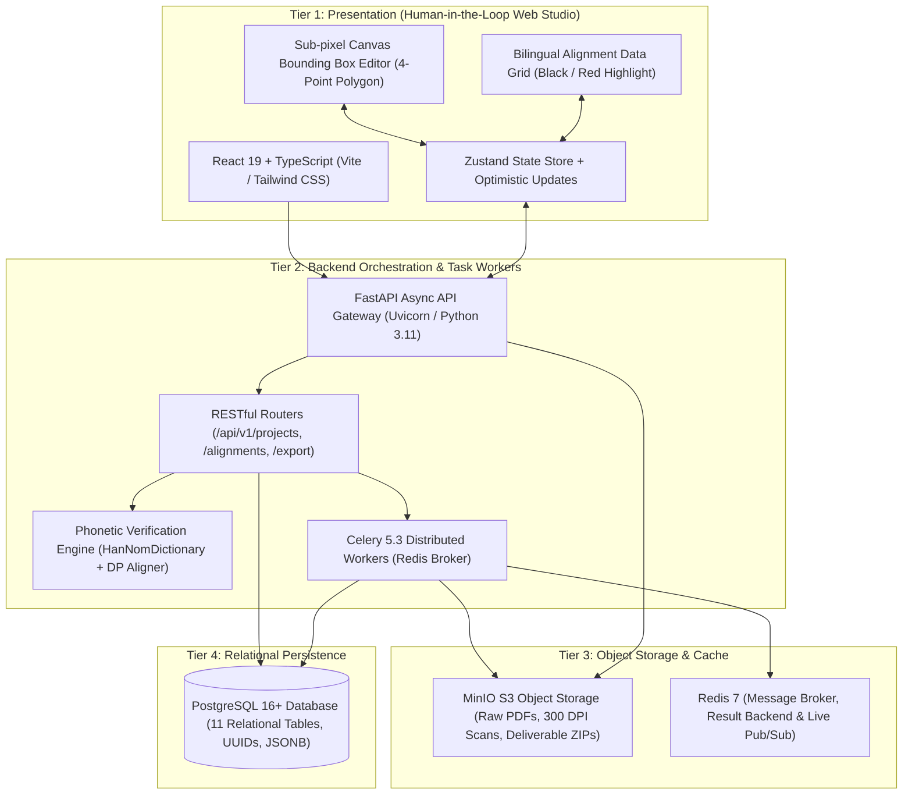
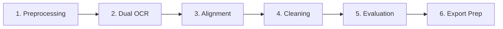
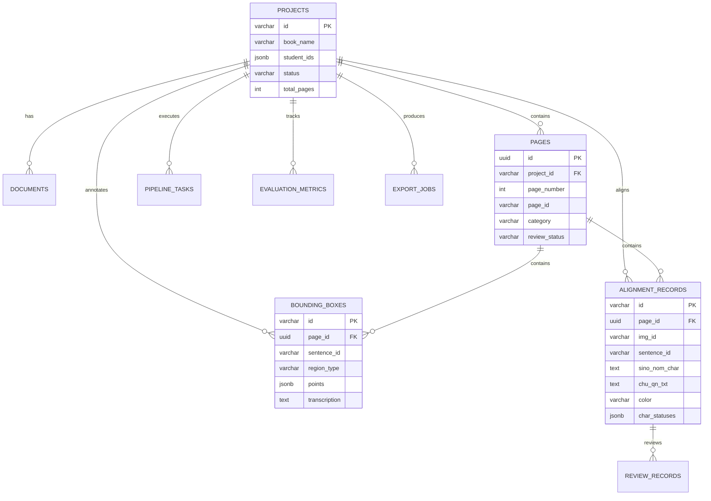

# Human-in-the-Loop Web Studio & Pipeline Architecture Specification

An enterprise-grade, 4-tier human-in-the-loop platform designed for historical Sino-Nom manuscript digitization, bilingual sentence alignment, dictionary verification, and academic corpus publishing.

---

## 1. System Architecture Overview

The system follows a strict **Layered Enterprise Architecture (4-Tier)** separating presentation, orchestration, compute workers, object storage, and relational metadata persistence.



### Architectural Principles:
1. **Decoupled Heavy Compute**: Heavy OCR inference and PDF rendering run asynchronously via Celery background tasks; the FastAPI request-response loop is strictly non-blocking.
2. **Sub-millisecond Interactive Feedback**: When an expert edits a character in the frontend grid or canvas, character-level phonetic lookup runs with sub-millisecond latency, recalculating the similarity score dynamically.
3. **Graceful Fallback Architecture**: The system functions in full Docker Compose microservices mode (PostgreSQL + Redis + MinIO + Celery) and gracefully falls back to local disk storage and synchronous processing for local standalone development.
4. **Strict Compliance Validation**: Pre-flight validation guarantees that every artifact exported matches academic standards before a ZIP is packaged.

---

## 2. 6-Stage NLP Processing Pipeline



| Stage | Name | Key Operations | Artifact Output |
|---|---|---|---|
| **1** | **Preprocessing** | PDF rendering at 300 DPI, Laplacian blur detection ($\sigma^2 \ge 50$), content/misc/blank classification, T2b red margin line detection ($x \approx 260\text{ px}$). | Scanned JPG pages, category tags |
| **2** | **Dual OCR** | Recognition of Sino-Nom characters and cursive handwritten Vietnamese Quốc ngữ text lines. | Raw character candidates & bounding boxes |
| **3** | **Alignment** | Dynamic Programming (DP) sentence-level alignment using phonetic pronunciation dictionaries across page boundaries. | Initial parallel sentence pairs |
| **4** | **Cleaning** | Unicode NFC normalization, archaic punctuation filtering, PPOCRLabel 4-point polygon coordinate extraction. | Normalized text, valid 4-pt boxes |
| **5** | **Evaluation** | Cross-verification against 20,000+ Sino-Nom entries; ARGB Black/Red formatting; similarity calculation. | Phonetic match flags, similarity score |
| **6** | **Export Prep** | Production of `Label.txt`, `fileState.txt`, UTF-8 BOM CSV, and ARGB-styled Excel sheets. | `<MSSV1_MSSV2...>.zip` package |

---

## 3. Similarity Metric & Quality Gate

Every record and dataset must pass the strict academic quality gate:

$$\text{Similarity Score} = \left( 1 - \frac{N_{\text{mismatch}}}{N_{\text{total}}} \right) \times 100 \ge 95.0\%$$

- **$N_{\text{total}}$**: Total number of Sino-Nom characters evaluated.
- **$N_{\text{mismatch}}$**: Total number of characters whose pronunciation does not match the Quốc ngữ text or is unindexed in the phonetic dictionary.
- **Color Coding**:
  - **Black (`FF000000`)**: Phonetically matched character pairs ($\ge 95\%$).
  - **Red (`FFFF0000`)**: Mismatched or out-of-vocabulary characters requiring human-in-the-loop review.

---

## 4. Database Schema Specification (PostgreSQL 16+)

The database schema is defined in [init.sql](file:///docker/postgres/init.sql) and contains 11 normalized relational tables:



---

## 5. Academic Deliverable Specification

The final export package generated by `ExportService` strictly obeys the academic archive structure:

```
<MSSV1_MSSV2...>.zip
└── <Book_Name>/
    ├── ch/
    │   ├── Label.txt               # PPOCRLabel annotations (tab-separated, strict 4 points)
    │   ├── fileState.txt           # Label completion status (1 or 0, tab-separated)
    │   └── <Book_Name>.<page>.jpg  # Sino-Nom manuscript scans
    ├── vi/
    │   ├── Label.txt               # PPOCRLabel annotations for Quốc ngữ
    │   ├── fileState.txt           # Completion status
    │   └── <Book_Name>.<page>.jpg  # Quốc ngữ manuscript scans
    ├── misc/
    │   └── <Book_Name>.<page>.jpg  # Cover, preface, and index pages
    ├── blank/
    │   └── <Book_Name>.<page>.jpg  # Blank or back-cover pages
    ├── <Book_Name>.csv             # 4 columns with UTF-8 BOM encoding
    └── <Book_Name>.xlsx            # 4 columns with ARGB font styling (Black/Red)
```

### Strict Bounding Box Coordinate Rule:
Each entry in `Label.txt` must have **strictly 4 polygon coordinate points**:
```json
[
  {"transcription": "...", "points": [[x1, y1], [x2, y2], [x3, y3], [x4, y4]]}
]
```

### Strict 4-Column Corpus Schema:
Both the CSV and XLSX deliverable files must contain exactly four columns:
1. `img_id`: Full filename of the scanned page (e.g., `Ca Trù Thê Cách, AB 160, Nôm_Y.006.jpg`).
2. `sentence_id`: Unique identifier formatted as `<img_id without .jpg>.<index>` (e.g., `Ca Trù Thê Cách, AB 160, Nôm_Y.006.1`).
3. `SinoNom_Char`: Text transcription of the Sino-Nom line.
4. `ChuQN_txt`: Corresponding modern Vietnamese Quốc ngữ line.

---

## 6. API Reference (FastAPI Orchestrator)

All endpoints are available under `/api/v1` and mirrored at `/api` for frontend routing:

| Endpoint | Method | Description |
|---|---|---|
| `/api/health` | `GET` | Health check, service status, and loaded record count |
| `/api/v1/projects/{project_id}` | `GET` | Project metadata, book name, student IDs, total pages |
| `/api/v1/projects/{project_id}/pipeline` | `GET` | Telemetry of the 6 pipeline stages |
| `/api/v1/projects/{project_id}/pages` | `GET` | Scanned page manifest with category and issue count |
| `/api/v1/projects/{project_id}/pages/{page}/annotations` | `GET` | 4-point polygon bounding boxes for canvas overlay |
| `/api/v1/bounding_boxes/{box_id}` | `PUT` | Update bounding box coordinates and transcription |
| `/api/v1/projects/{project_id}/alignments` | `GET` | Full parallel corpus records with character status |
| `/api/v1/alignments/{record_id}` | `PATCH` | Edit record text; automatically re-evaluates phonetic match |
| `/api/v1/projects/{project_id}/metrics` | `GET` | Real-time similarity metrics and pass/fail status |
| `/api/v1/projects/{project_id}/export/validate` | `GET` | Pre-flight validation against all 6 academic rules |
| `/api/v1/projects/{project_id}/export` | `POST` | Packages and streams `<MSSV1_MSSV2...>.zip` |

---

## 7. Deployment & Operational Runbook

### Option A: Complete Docker Compose Deployment (Recommended for Production)

Run the entire 6-container stack with a single command:

```bash
docker compose up -d --build
```

Access the services:
- **Web Studio (Frontend)**: `http://localhost:3000`
- **FastAPI API Documentation**: `http://localhost:8000/docs`
- **MinIO Object Console**: `http://localhost:9001` (Credentials: `minioadmin` / `minioadmin`)
- **PostgreSQL Database**: `localhost:5432` (`sinonom_db`)

To stop the containers:
```bash
docker compose down
```

### Option B: Local Standalone Development (Host-Only)

1. **Start the FastAPI Backend**:
   ```powershell
   $env:PYTHONPATH="backend;.core;."
   python -m uvicorn app.main:app --host 127.0.0.1 --port 8000 --reload
   ```

2. **Start the React Frontend**:
   ```powershell
   cd web-studio
   npm run dev
   ```
   Open `http://127.0.0.1:5173` in your browser.

3. **Run Unit & Integration Tests**:
   ```powershell
   # Run frontend Vitest test suite
   npm --prefix web-studio run test

   # Run backend health and pre-flight validation check
   curl.exe -s http://127.0.0.1:8000/api/v1/projects/proj_ab160_midterm/export/validate
   ```
