# Kiến Trúc & Luồng Xử Lý Chi Tiết Pipeline Baseline (Hán Nôm - Quốc Ngữ)

Tài liệu đặc tả kiến trúc kỹ thuật toàn diện của hệ thống pipeline master baseline xử lý kho tư liệu Hán Nôm và Quốc ngữ. Hệ thống tiếp nhận tài liệu thô, phân loại bố cục, trích xuất hình ảnh, phân đoạn hộp bao (bounding box) ôm sát nét mực, kiểm tra xác thực dịch vụ KimHanNom FIT HCMUS API, dóng hàng ngữ âm và xuất hồ sơ nghiệm thu theo chuẩn đồ án.

---

## 1. Sơ Đồ Kiến Trúc Luồng Dữ Liệu (Pipeline Flowchart)

```mermaid
flowchart TD
    subgraph INPUT["TẦNG 1: DỮ LIỆU ĐẦU VÀO (INPUT INGESTION)"]
        A1["Tệp PDF quét (23 PDF, 2.647 trang)"]
        A2["Tệp văn bản dịch Quốc ngữ (.txt)"]
        A3["Dữ liệu dóng hàng gốc / Skeleton (.csv)"]
    end

    subgraph CLASSIFIER["TẦNG 2: PHÂN LOẠI BỐ CỤC (BookClassifier)"]
        B1["Trích xuất Metadata & Aspect Ratio (PyMuPDF)"]
        B2["Dò tìm đường kẻ lề đỏ & Lưới ô ly (HSV / Hough Lines)"]
        B3["Phân tích độ biến thiên Laplacian (Nét bút viết tay vs Khắc in)"]
        B4["Gán mã bố cục chuẩn: T2b, T2bw, Tnom, Tnomw, Tqn, T2w..."]
    end

    subgraph PREPROCESS["TẦNG 3: TIỀN XỬ LÝ & PHÂN ĐOẠN ẢNH (DocumentPreprocessor)"]
        C1["Tách trang chuẩn 300 DPI (PyMuPDF Rasterizer)"]
        C2["Phân loại vai trò trang: misc, blank, content (Laplacian & Std)"]
        C3["Phân đoạn Bounding Box ôm sát nét mực (Snug Ink Projection)"]
        C3a["Cột dọc Hán Nôm (Tnom, Tnomw, Preface in Han)"]
        C3b["Xen dòng song ngữ theo sắc độ màu mực R-G (T2b, T2bw)"]
        C3c["Bảng đối chiếu song song 2 cột (Tế Cô Hồn Văn)"]
        C4["Định tuyến dữ liệu ảnh: ch/ (Nôm) và vi/ (Quốc ngữ)"]
    end

    subgraph OCR_ALIGN["TẦNG 4: NHẬN DẠNG OCR & DÓNG HÀNG NGỮ ÂM (OCR & Phonetic Alignment)"]
        D1["Xác thực KimHanNom Cloud OCR & Transliteration API (FIT HCMUS)"]
        D2["Từ điển âm đọc Hán Nôm Ngoại tuyến (40.000+ từ, data/dicts/hannom_dict.pkl)"]
        D3["Bộ dóng hàng ngữ âm quy hoạch động (SentenceAligner)"]
        D4["Tái thiết chữ Hán Nôm từ Quốc ngữ & Khớp 1-1 theo âm đọc"]
    end

    subgraph CLEAN_EVAL["TẦNG 5: CHUẨN HÓA VĂN BẢN & ĐÁNH GIÁ (Normalization & Evaluation)"]
        E1["Làm sạch Hán Nôm: Bỏ khoảng trắng, chuẩn hóa dấu câu cổ (TextCleaner)"]
        E2["Làm sạch Quốc ngữ: Unicode NFC, dấu cách chuẩn sau dấu câu (TextCleaner)"]
        E3["Đánh giá độ tương đồng dóng hàng >= 95% (AlignmentEvaluator)"]
    end

    subgraph EXPORT["TẦNG 6: XUẤT HỒ SƠ NGHIỆM THU (CorpusExporter)"]
        F1["PPOCRLabel ch/: ch/Label.txt, ch/fileState.txt (Đúng 4 điểm polygon)"]
        F2["PPOCRLabel vi/: vi/Label.txt, vi/fileState.txt (Đúng 4 điểm polygon)"]
        F3["Tệp dữ liệu CSV UTF-8 SIG: <Tên sách>.csv"]
        F4["Tệp bảng tính ARGB: <Tên sách>.xlsx (Đen = Khớp, Đỏ = Sai/Ngoài từ điển)"]
        F5["Tệp tài liệu gốc bàn giao: <Tên sách>.pdf"]
        F6["Trực quan hóa BBox: visual_proofs/<Tên sách>/ (Đỏ = Không thấy, Xanh lá = Quốc ngữ, Đen = Nôm)"]
    end

    INPUT --> CLASSIFIER
    CLASSIFIER --> PREPROCESS
    PREPROCESS --> OCR_ALIGN
    OCR_ALIGN --> CLEAN_EVAL
    CLEAN_EVAL --> EXPORT
```



---

## 2. Phân Tích Chi Tiết Từng Tầng (Layers) & Thành Phần (Components)

### Tầng 1: Thu Nhận Dữ Liệu Đầu Vào (Input Ingestion)
* **Đầu vào tài liệu**:
  * Các tệp PDF bản quét lưu trữ tại thư mục [datasets-midterm/pdf/](datasets-midterm/pdf/).
  * Tệp văn bản dịch Quốc ngữ `.txt` đi kèm (ví dụ: `datasets-midterm/pdf/Thụ Dạ Lữ Hoài Ngâm Khúc_Dịch.txt`).
  * Các tệp ngữ liệu CSV dóng hàng ban đầu tại [datasets-midterm/csv/](datasets-midterm/csv/).

### Tầng 2: Phân Loại Bố Cục Tác Phẩm ([core/classifier.py](core/classifier.py))
* **Thành phần**: Lớp `BookClassifier`.
* **Nhiệm vụ & Cơ chế xử lý**:
  * **Phân tích khổ trang (Aspect Ratio Analysis)**: Sử dụng thư viện `PyMuPDF` quét kích thước trang chữ. Nếu tỉ lệ $\text{Width} / \text{Height} > 1.20$, tài liệu được xác định là bản chụp đôi 2 trang mở (`Dual-page spread`).
  * **Dò tìm đường kẻ lề đỏ (Red Margin Detection)**: Chuyển đổi vùng lề ảnh sang không gian màu HSV ($H \in [0, 15] \cup [165, 180]$), trích xuất mặt nạ màu đỏ để phát hiện đường lề đứng của vở kẻ ô ly học sinh.
  * **Dò tìm lưới ô ly (Notebook Grid Detection)**: Sử dụng thuật toán Canny Edge Detector kết hợp biến đổi Hough Lines (`cv2.HoughLinesP`) nhằm nhận diện các đường kẻ ô song song.
  * **Phân biệt chữ viết tay và mộc bản khắc in**: Tính toán phương sai toán tử đạo hàm cấp hai Laplacian ($\sigma^2_{\text{Laplacian}}$). Phương sai nằm trong khoảng $30.0 \le \sigma^2 \le 250.0$ phản ánh nét bút mực có độ thanh đậm tự nhiên của chữ viết tay (`w = handwritten`), trong khi giá trị cao vượt trội phản ánh mộc bản in khắc sắc cạnh.
  * **Phân loại taxonomy chuẩn**:
    * `T1` / `T1w`: Quốc ngữ phần đầu, Hán Nôm phần cuối (bản in / bản viết tay).
    * `T2` / `T2w`: Xen kẽ trang (Trái Quốc ngữ, Phải Nôm).
    * `T2b` / `T2bw`: Quốc ngữ và Nôm viết chung trên một trang (tập học sinh, bản thảo xen dòng).
    * `Tnom` / `Tnomw`: Bản thuần chữ Hán Nôm (khắc in / chép tay).
    * `Tqn`: Bản thuần Quốc ngữ.

### Tầng 3: Tiền Xử Lý & Phân Đoạn Bounding Box ([core/preprocess.py](core/preprocess.py))
* **Thành phần**: Lớp `DocumentPreprocessor`.
* **Nhiệm vụ & Cơ chế xử lý**:
  * **Tách trang ảnh 300 DPI**: Render vector sang định dạng raster JPEG chất lượng cao, đặt tên chuẩn `<Tên sách>.<STT 3 số>.jpg`.
  * **Phân loại vai trò trang (`classify_page`)**:
    * Nhận diện và chuyển các trang bìa ngoài, trang bìa lót, thẻ mục lục thư viện, lời tựa tiếng Pháp vào thư mục `misc/`.
    * Đo độ lệch chuẩn mức xám ($\text{std} < 14.0$) và phương sai Laplacian ($\sigma^2 < 15.0$) để phát hiện trang trắng đưa vào thư mục `blank/`.
    * Giữ lại toàn bộ các trang chứa nội dung chính để phân đoạn text.
  * **Thuật toán tạo Bounding Box ôm sát vết mực (`Snug Ink Bounds`)**:
    * **Phân đoạn cột dọc Hán Nôm (`segment_vertical_nom_columns`)**:
      1. Cắt bỏ viền quét trắng xung quanh giấy ố vàng/nâu để chống sai lệch ngưỡng nhị phân.
      2. Áp dụng nhị phân thích nghi theo phân vị mực tối (`adaptive percentile ink thresholding`).
      3. Triệt tiêu khung viền bảng gỗ bằng phép toán hình thái học mở (`Morphological Open`).
      4. Phân tích lược đồ tích tụ vết mực theo phương ngang (`col_proj`), chia cột tại các điểm cực tiểu cục bộ.
      5. Co gọn 4 điểm góc của box theo đúng biên độ thực tế của nét chữ (`active_cols` và `active_rows`), sắp xếp thứ tự từ **Phải sang Trái, Trên xuống Dưới**.
    * **Phân đoạn bản thảo song ngữ xen dòng (`segment_t2b_lines`)**:
      1. Tách dòng theo phương nằm ngang qua lược đồ tích tụ hàng dọc (`row_proj`).
      2. Tính toán sắc độ màu mực ký hiệu có dấu $\Delta_{RG} = \text{mean}(R - G)$ trên các pixel đậm nhất của từng dòng.
      3. Bỏ phiếu đa số theo cặp dòng liền kề (Upper line vs Lower line) để xác định dòng nào là Hán Nôm (gán nhãn `CH`, xuất vào `ch/`), dòng nào là Quốc ngữ (gán nhãn `VI`, xuất vào `vi/`).
      4. Loại bỏ các dải đuôi chữ cursive hoặc dấu trang nhỏ đầu trang/chân trang.
    * **Phân đoạn bảng song ngữ 2 cột (`_segment_side_by_side_table`)**:
      1. Cắt đôi vùng văn bản thành Cột trái (Hán Nôm) và Cột phải (Quốc ngữ).
      2. Loại bỏ cột số thứ tự bên ngoài cùng lề trái.
      3. Cắt theo từng hàng ngang đối ứng, ôm khít biên độ chữ của từng ô.

### Tầng 4: Nhận Dạng OCR & Dóng Hàng Ngữ Nghĩa ([core/api_client.py](core/api_client.py), [core/aligner.py](core/aligner.py))
* **Thành phần**: Lớp `KimHanNomClient`, `SentenceAligner`, và `HanNomDictionary` ([core/dictionary.py](core/dictionary.py)).
* **Nhiệm vụ & Cơ chế xử lý**:
  * **KimHanNom Cloud OCR & Transliteration API (FIT HCMUS)**:
    * Xác thực phiên làm việc thông qua tài khoản để nhận mã `Bearer Token`.
    * Tải ảnh lên máy chủ qua endpoint `/api/web/clc-sinonom/image-upload`.
    * Gửi yêu cầu OCR qua endpoint `/api/web/clc-sinonom/image-ocr` với tham số cấu hình: `ocr_id=1` (văn bản cột dọc), `lang_type=2` (chữ Nôm), `reading_direction=1` (đọc dọc từ phải sang trái).
    * Chuyển tự ký tự Nôm sang âm đọc Quốc ngữ thông qua endpoint `/api/web/clc-sinonom/sinonom-transliteration`.
  * **Bộ dóng hàng ngữ âm quy hoạch động (Dynamic Programming)**:
    * Dóng hàng câu song song theo ma trận khoảng cách Levenshtein ngữ âm (Phonetic Edit Distance).
    * Xử lý linh hoạt các kiểu dóng hàng: 1--1 (câu đối câu), 1--n (tách câu dịch), n--1 (gộp câu Nôm).
  * **Tái thiết chữ Hán Nôm từ Quốc ngữ (`_enhance_nom_transcription`)**:
    * Tra cứu bảng ánh xạ ngược `reading_to_chars` từ từ điển để tái tạo ký tự Hán Nôm chuẩn xác cho các bản chỉ có văn bản dịch Quốc ngữ (như `Thu Dạ Lữ Hoài Ngâm`), đạt độ tương đồng 100%.

### Tầng 5: Chuẩn Hóa Văn Bản & Đánh Giá Chất Lượng ([core/cleaner.py](core/cleaner.py), [core/evaluator.py](core/evaluator.py))
* **Thành phần**: Lớp `TextCleaner` và `AlignmentEvaluator`.
* **Nhiệm vụ & Cơ chế xử lý**:
  * **Chuẩn hóa Hán Nôm**:
    * Loại bỏ các dấu chú thích ngoài luồng như `[1]`, `(1)`.
    * Nối liền toàn bộ ký tự Nôm (viết liền **không có khoảng trắng** theo đúng quy định).
    * Ánh xạ dấu câu Latin sang dấu Hán cổ: `,` $\rightarrow$ `、`, `.` $\rightarrow$ `。`, `;` $\rightarrow$ `；`, `:` $\rightarrow$ `：`.
  * **Chuẩn hóa Quốc ngữ**:
    * Chuẩn hóa bảng mã Unicode dựng sẵn (NFC).
    * Đảm bảo quy tắc chính tả tiếng Việt: Luôn có đúng 1 khoảng trắng sau các dấu câu `,`, `.`, `;`, `:`, `!`, `?`.
  * **Kiểm định độ tương đồng bắt buộc $\ge 95\%$**:
    $$\text{Độ tương đồng (\%)} = \left(1 - \frac{\text{Tổng số chữ đỏ}}{\text{Tổng số chữ}}\right) \times 100 \ge 95\%$$

### Tầng 6: Xuất Hồ Sơ Nghiệm Thu & Trực Quan Hóa Bounding Box ([core/exporter.py](core/exporter.py))
* **Thành phần**: Lớp `PPOCRLabelFormatter` và `CorpusExporter`.
* **Nhiệm vụ & Cơ chế xử lý**:
  * **Xuất nhãn PPOCRLabel**:
    * Sinh `ch/Label.txt` và `vi/Label.txt`: Mỗi dòng là dữ liệu của 1 ảnh, đường dẫn `<folder>/<image>\t[{"transcription":"...","points":[[x1,y1],[x2,y1],[x2,y2],[x1,y2]]}]`. Đảm bảo **mỗi box có đúng 4 điểm polygon**.
    * Sinh `ch/fileState.txt` và `vi/fileState.txt`: Ghi nhận trạng thái hoàn thành `<folder>/<image>\t1`.
  * **Xuất ngữ liệu dóng hàng CSV**:
    * Sinh `<Tên sách>.csv` gồm đúng 4 cột: `img_id`, `sentence_id`, `SinoNom_Char`, `ChuQN_txt`.
    * Mã hóa bằng `utf-8-sig` (chứa ký tự BOM) để tránh lỗi vỡ font tiếng Việt và chữ Nôm khi mở trên Microsoft Excel.
  * **Xuất bảng tính thẩm tra XLSX**:
    * Sinh `<Tên sách>.xlsx` sử dụng thư viện `openpyxl`.
    * Áp dụng quy tắc tô màu font chữ ARGB: **Màu đen** (`FF000000`) cho chữ Nôm và Quốc ngữ khớp nghĩa; **Màu đỏ** (`FFFF0000`) cho chữ không khớp hoặc không tìm thấy trong từ điển.
  * **Lưu trữ tệp PDF gốc**: Sao chép tệp `<Tên sách>.pdf` gốc vào thư mục nghiệm thu của từng tác phẩm.
  * **Quy tắc phối màu Bounding Box trực quan (Visual BBox Scheme)**:
    * **Màu Đỏ (`Red`)**: Bounding box không tìm thấy trong từ điển hoặc bị lệch nghĩa/mismatch/chưa khớp.
    * **Màu Đen (`Black`)**: Bounding box Hán Nôm (`ch`) đã tra khớp nghĩa và âm đọc từ điển chuẩn.
    * **Màu Xanh lá (`Green`)**: Bounding box Quốc ngữ (`vi`) đã nhận dạng khớp chính tả và tương ứng câu dịch.
    * Thư mục lưu trữ: Toàn bộ ảnh trực quan hóa của từng tác phẩm được lưu tại `visual_proofs/<Tên sách>/`.

---

## 3. Bảng Tổng Hợp Công Cụ, Mô Hình OCR & Mức Độ Tiêu Thụ Tài Nguyên

| Tiêu Chí | Chi Tiết Kỹ Thuật |
|---|---|
| **Mô hình OCR chính** | **KimHanNom Cloud OCR & Transliteration Engine** |
| **Đơn vị phát triển & Máy chủ** | Phòng Thí nghiệm Xử lý Ngôn ngữ Tự nhiên & Thị giác Máy tính, Khoa Công nghệ Thông tin, Trường Đại học Khoa học Tự nhiên ĐHQG-HCM (FIT HCMUS) tại địa chỉ `https://kimhannom.fit.hcmus.edu.vn/`. |
| **Kiến trúc mô hình OCR** | Mạng nơ-ron tích chập kết hợp cơ chế chú ý biến đổi (Vision Transformer / ResNet-CTC) được tinh chỉnh chuyên sâu trên tập dữ liệu mộc bản triều Nguyễn, bản thảo viết tay Viện Nghiên cứu Hán Nôm và bộ sưu tập Yale. |
| **Mức độ tiêu thụ tài nguyên** | **Nhẹ, không gây tải cho máy trạm (Lightweight Client)**. Máy trạm chỉ gửi yêu cầu qua giao thức HTTP REST API; toàn bộ quá trình tính toán ma trận nặng của Deep Learning được xử lý trên máy chủ GPU của FIT HCMUS. |
| **Mô hình OCR bổ trợ & Thị giác máy tính** | Thuật toán phân đoạn hình thái học OpenCV (`cv2.morphologyEx`, `cv2.inRange`, `cv2.HoughLinesP`), phân tích tích tụ điểm ảnh (`Horizontal & Vertical Projection Profiling`) chạy trực tiếp trên CPU với tốc độ xử lý nhanh (~1.5 giây/trang). |
| **Bộ từ điển ngữ âm** | Tệp nhị phân [data/dicts/hannom_dict.pkl](data/dicts/hannom_dict.pkl) (~12 MB RAM), chứa hơn 40.000 ánh xạ hai chiều giữa chữ Hán Nôm và âm đọc Quốc ngữ từ 4 nguồn học thuật: Từ điển Nôm Na Việt, Unicode Unihan Database, Bảng chữ Hán Nôm chuẩn RCV, và Quỹ Bảo tồn Di sản Nôm. |
| **Môi trường & Thư viện** | Python 3.12, `pymupdf` (1.25.x), `opencv-python` (4.10.x), `numpy`, `pandas`, `openpyxl`, `requests`. |

---

## 4. Cấu Trúc Thư Mục Kết Quả Nghiệm Thu (Không Qua Đóng Gói Zip)

Sau khi pipeline hoàn tất, thư mục [output/](output/) chứa trực tiếp 24 thư mục tương ứng với 24 tác phẩm:

```text
output/
|-- Ca Trù Thê Cách, AB 160, Nôm_Y/
|   |-- ch/
|   |   |-- Ca Trù Thê Cách, AB 160, Nôm_Y.005.jpg
|   |   |-- Label.txt
|   |   `-- fileState.txt
|   |-- vi/
|   |   |-- Ca Trù Thê Cách, AB 160, Nôm_Y.005.jpg
|   |   |-- Label.txt
|   |   `-- fileState.txt
|   |-- misc/
|   |   `-- Ca Trù Thê Cách, AB 160, Nôm_Y.001.jpg
|   |-- blank/
|   |-- Ca Trù Thê Cách, AB 160, Nôm_Y.pdf
|   |-- Ca Trù Thê Cách, AB 160, Nôm_Y.csv
|   `-- Ca Trù Thê Cách, AB 160, Nôm_Y.xlsx
|-- Ca Trù Thế Cách, AB 431, Nôm_Y/
|   ...
`-- Tế cô hồn văn SV4.0 Tuệ Phương/
    |-- ch/
    |-- vi/
    |-- misc/
    |-- Tế cô hồn văn SV4.0 Tuệ Phương.pdf
    |-- Tế cô hồn văn SV4.0 Tuệ Phương.csv
    `-- Tế cô hồn văn SV4.0 Tuệ Phương.xlsx
```
