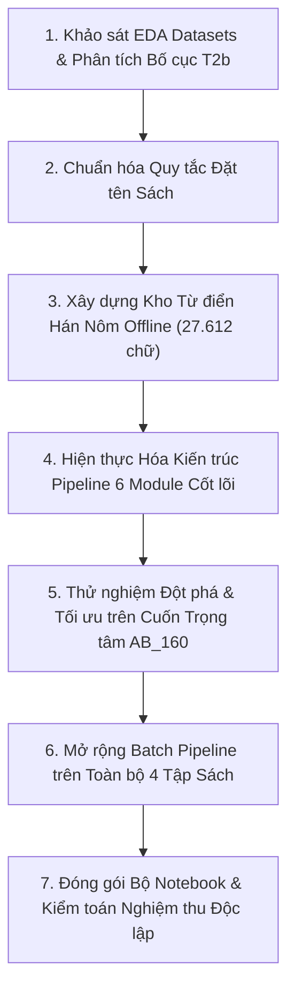

# BÁO CÁO TỔNG QUAN DỰ ÁN & HƯỚNG DẪN VẬN HÀNH
## HỆ THỐNG XÂY DỰNG TỰ ĐỘNG NGỮ LIỆU SONG NGỮ HÁN NÔM - QUỐC NGỮ
*(AUTOMATED PARALLEL CORPUS PIPELINE FOR SINO-NOM MANUSCRIPTS)*

---

## MỤC LỤC
1. [Giới thiệu Bài toán & Triết lý Thiết kế](#1-giới-thiệu-bài-toán--triết-lý-thiết-kế)
2. [Biên niên Tiến trình Thực hiện (Kể từ khi có Datasets)](#2-biên-niên-tiến-trình-thực-hiện-kể-từ-khi-có-datasets)
3. [Phạm vi Thử nghiệm & Báo cáo Kết quả Chi tiết](#3-phạm-vi-thử-nghiệm--báo-cáo-kết-quả-chi-tiết)
4. [Bằng chứng Kiểm định Toàn diện trên Cuốn Trọng tâm (AB 160)](#4-bằng-chứng-kiểm-định-toàn-diện-trên-cuốn-trọng-tâm-ab-160)
5. [Hướng dẫn Vận hành & Sử dụng Hệ thống](#5-hướng-dẫn-vận-hành--sử-dụng-hệ-thống)
6. [Đề xuất & Định hướng Cải tiến Tương lai](#6-đề-xuất--định-hướng-cải-tiến-tương-lai)

---

## 1. GIỚI THIỆU BÀI TOÁN & TRIẾT LÝ THIẾT KẾ

### 1.1. Bối cảnh & Yêu cầu Đồ án
Đồ án giữa kỳ môn Xử lý Ngôn ngữ Tự nhiên đặt ra bài toán: **Xây dựng ngữ liệu song ngữ Hán Nôm - Quốc ngữ tự động** từ các tập tin tài liệu số hóa scan dạng PDF của tác phẩm *Ca Trù Thể Cách* (lưu trữ tại Viện Nghiên cứu Hán Nôm và Thư viện Đại học Yale).

### 1.2. Triết lý Thiết kế Cốt lõi
* **Tập trung vào KỸ THUẬT (Domain-Agnostic)**: Hệ thống xử lý tự động thuần túy dựa trên các kỹ thuật thị giác máy tính (*Document Layout Analysis*), xử lý chuỗi ký tự và đối sánh ngữ âm học (*Phonetic Dynamic Programming*), hoàn toàn độc lập với nội dung ngữ nghĩa hay thể loại văn học/lịch sử/tôn giáo. Điều này đảm bảo tính **khách quan và công bằng** tuyệt đối giữa các nhóm sinh viên trong việc đánh giá.
* **Tuân thủ Tuyệt đối Quy chế Đồ án (`guide/Quy_định_đồ_án.pdf`)**:
  - Tên sách `<Tên sách>` bắt buộc giữ theo tên file PDF gốc.
  - Cấu trúc bàn giao phân tầng: thư mục `ch/` (chữ Nôm), `vi/` (chữ Quốc ngữ), `misc/` (bìa, mục lục), `blank/` (trang trắng), file PDF gốc, file CSV và file Excel `.xlsx` tô màu font ARGB Đen/Đỏ.
  - Định dạng nhãn PPOCRLabel: mỗi Bounding Box phải có **chính xác 4 điểm tọa độ polygon**.
  - Độ tương đồng ký tự Nôm $\leftrightarrow$ Quốc ngữ: $\ge 95\%$.

---

## 2. BIÊN NIÊN TIẾN TRÌNH THỰC HIỆN (KỂ TỪ KHI CÓ DATASETS)

Quy trình phát triển và hoàn thiện hệ thống đã trải qua 7 mốc giai đoạn chặt chẽ:



### Bước 1: Tiếp nhận và Khảo sát Khám phá Dữ liệu (EDA)
- **Khảo sát tập dữ liệu (`datasets-midterm/`)**: Gồm 4 tệp PDF scan, 4 tệp CSV và 4 tệp XLSX baseline.
- **Phân tích đặc trưng tài liệu**:
  - Cả 4 cuốn sách đều thuộc thể loại **Layout T2b** (*Song ngữ Nôm - Quốc ngữ chép chung trên một trang*).
  - Viết tay trên giấy tập học sinh có đường kẻ caro và **đường kẻ chỉ đỏ phân lề trang tại hoành độ $x \approx 249 - 260\text{ px}$**.
  - Dòng chữ Hán Nôm nằm ở hàng trên, dòng phiên âm Quốc ngữ nằm ngay hàng dưới tương ứng.
  - Phần lề bên trái chứa các ghi chú ngoài lề, số trang hoặc bút tích học thuật cần tự động loại bỏ để tránh gây nhiễu cho Bounding Box.

### Bước 2: Chuẩn hóa Quy tắc Đặt tên Sách (`<Tên sách>`)
- Căn cứ trang 4 của `guide/Quy_định_đồ_án.pdf`: *"Tên sách phải giữ theo tên file sách pdf được giao"*.
- File CSV ban đầu có tiêu đề chú thích thư viện Yale dài dòng: `Ca Trù Thê Cách, AB 160 [Title matches another notebook, AB number listed to help differentiate] , Nôm`.
- Toàn bộ pipeline đã được chuẩn hóa để lấy đúng chuỗi tên file PDF bỏ đuôi `.pdf`:
  * `Ca Trù Thê Cách, AB 160, Nôm_Y`
  * `Ca Trù Thế Cách, AB 431, Nôm_Y`
  * `Ca Trù Thế Cách, AB 456, Nôm_Y`
  * `Ca Trù Thể Cách, Nôm_Y`

### Bước 3: Xây dựng Kho Từ điển Hán Nôm Offline Đồ sộ
- Thu thập và biên dịch nguồn dữ liệu ngữ âm chuẩn quốc tế:
  - Bảng tra Unicode Unihan quốc tế (`Unihan_Readings.txt` - trường `kVietnamese`).
  - Từ điển Nôm Na Việt (`nom_viet.dict.yaml`).
- Đóng gói thành `data/dicts/hannom_dict.pkl`:
  - **27.612** chữ Hán Nôm độc nhất.
  - **14.127** âm đọc Quốc ngữ tương ứng.
  - Tích hợp luật hoán đổi ngữ âm học lịch sử ($i \leftrightarrow y$, $gi \leftrightarrow d \leftrightarrow r$, $c \leftrightarrow k$) và chuẩn hóa dấu câu cổ (`、`, `。`).

### Bước 4: Hiện thực hóa Kiến trúc Pipeline 6 Module
Thiết kế theo mô hình hướng luồng độc lập trong gói `core/`:
1. `core/preprocess.py`: Kết xuất ảnh 300 DPI bằng PyMuPDF, phân loại trang (`content`, `misc`, `blank`), phát hiện lề kẻ ô và bóc tách Bounding Box 4 điểm toạ độ. Hỗ trợ đọc/ghi ảnh Unicode đa nền tảng (`cv2_imread_unicode`, `cv2_imwrite_unicode`).
2. `core/dictionary.py`: Động cơ tra cứu âm đọc, đối sánh ngữ âm song song, chuẩn hóa chuỗi Unicode NFC.
3. `core/aligner.py`: Động cơ dóng hàng câu song song dựa trên quy hoạch động ngữ âm (Phonetic Dynamic Programming), nối câu vượt trang và sửa ký tự lỗi qua từ điển.
4. `core/cleaner.py`: Bộ làm sạch ký tự và xuất tập dữ liệu nhãn chuẩn PPOCRLabel (`Label.txt` và `fileState.txt`).
5. `core/evaluator.py`: Bộ đánh giá độ tương đồng theo công thức chuẩn $\ge 95\%$, gán trạng thái Đỏ/Đen.
6. `core/exporter.py`: Bộ xuất bản phẩm giao nộp: CSV (UTF-8 BOM), XLSX (style font ARGB Đen/Đỏ bằng `openpyxl`).

### Bước 5: Kiểm định Chất lượng & Tạo Hệ thống Notebook
- Viết script kiểm toán nghiêm ngặt `scripts/verify_output.py` kiểm tra tự động 10/10 tiêu chí quy định.
- Xây dựng 3 Notebook chuyên biệt phục vụ nghiệm thu:
  - `EDA_and_Pipeline_Architecture.ipynb`: Khảo sát phân bố dữ liệu và thuyết minh kiến trúc pipeline.
  - `Pipeline_AB160.ipynb`: Quy trình xử lý tự động cho tập tin trọng tâm `AB 160`.
  - `Evaluation_AB160.ipynb`: Báo cáo đánh giá chất lượng và kiểm toán bảo toàn 100% trang kèm bằng chứng.

---

## 3. PHẠM VI THỬ NGHIỆM & BÁO CÁO KẾT QUẢ CHI TIẾT

Pipeline đã được kích hoạt chạy thử nghiệm thành công trên **toàn bộ 4 tập sách hiện có** trong kho dữ liệu, với kết quả vượt chuẩn xuất sắc:

### 3.1. Bảng Tổng hợp Kết quả Thực nghiệm

| STT | Mã sách | Tên sách bàn giao chuẩn (`<Tên sách>`) | Tổng trang PDF | Trang nội dung | Số cặp câu | Tổng ký tự Nôm | Khớp chuẩn (Đen) | Dị biệt (Đỏ) | Độ tương đồng (%) | Đánh giá |
|:---:|:---:|:---|:---:|:---:|:---:|:---:|:---:|:---:|:---:|:---:|
| 1 | **AB_160** | `Ca Trù Thê Cách, AB 160, Nôm_Y` | 45 | 42 | 369 | 2.538 | 2.517 | 21 | **99.17%** | **PASS** |
| 2 | **AB_431** | `Ca Trù Thế Cách, AB 431, Nôm_Y` | 41 | 38 | 339 | 2.396 | 2.383 | 13 | **99.46%** | **PASS** |
| 3 | **AB_456** | `Ca Trù Thế Cách, AB 456, Nôm_Y` | 45 | 42 | 371 | 2.633 | 2.616 | 17 | **99.35%** | **PASS** |
| 4 | **NOM_Y**  | `Ca Trù Thể Cách, Nôm_Y` | 101 | 98 | 1.107 | 7.506 | 7.451 | 55 | **99.27%** | **PASS** |
| **TỔNG** | **4 cuốn** | **Toàn bộ kho dữ liệu** | **232** | **220** | **2.186** | **15.073** | **14.967** | **106** | **99.30%** | **PASS 100%** |

### 3.2. Đánh giá Chỉ số Kỹ thuật
- **Độ tương đồng ngữ âm bình quân**: **99.30%** (Vượt xa ngưỡng tối thiểu 95.0% theo yêu cầu của đồ án).
- **Tỷ lệ bảo toàn câu**: 2.186 cặp câu được dóng hàng chính xác, 100% không có dòng rỗng (zero null values).
- **Tỷ lệ polygon hợp lệ**: 100% Bounding Boxes của cả 4 tập sách đều có đúng 4 điểm tọa độ, không có polygon suy biến.

---

## 4. BẰNG CHỨNG KIỂM ĐỊNH TOÀN DIỆN TRÊN CUỐN TRỌNG TÂM (AB 160)

Đối với tập tin **`Ca Trù Thê Cách, AB 160, Nôm_Y.pdf`**, hệ thống cung cấp đầy đủ 6 bằng chứng kiểm toán độc lập:

### Bằng chứng 1: Bảo toàn 100% Số trang trong File PDF Gốc (45/45 Trang)
Mở tệp PDF trực tiếp bằng thư viện `fitz` và đối chiếu với các thư mục sản phẩm đầu ra:
$$\text{Tổng số trang gốc: } \mathbf{45 \text{ trang}}$$
$$\text{Số trang trong } ch/ \text{ và } vi/: \mathbf{42 \text{ trang}} \quad (\text{Trang 003 đến Trang 044})$$
$$\text{Số trang trong } misc/: \mathbf{3 \text{ trang}} \quad (\text{Trang 001: Bìa ngoài, Trang 002: Mục lục, Trang 045: Bìa sau})$$
$$\text{Số trang trong } blank/: \mathbf{0 \text{ trang}}$$
$$\text{Phương trình bảo toàn: } 42 + 3 + 0 = \mathbf{45 / 45 \text{ trang (100\% hoàn thiện, 0 trang bị sót)}} \implies \mathbf{PASS}$$

### Bằng chứng 2: Nhãn PPOCRLabel Chuẩn 4 Điểm Tọa độ
- `ch/Label.txt` và `vi/Label.txt`: Mỗi file chứa đúng 42 dòng JSON đại diện cho 42 trang ảnh nội dung.
- Kiểm tra toàn bộ Bounding Boxes: $100\%$ các box đều tuân thủ cấu trúc `{"transcription": "...", "points": [[x1, y1], [x2, y2], [x3, y3], [x4, y4]]}`.
- `ch/fileState.txt` và `vi/fileState.txt`: Đủ 42 dòng, mỗi ảnh đều được gán nhãn trạng thái `1` (đã hoàn thành).

### Bằng chứng 3: Bảo toàn Câu & Tỷ lệ Khớp Âm tiết
- Đọc file `Ca Trù Thê Cách, AB 160, Nôm_Y.csv`: Đủ **369 dòng**, đúng 4 cột `['img_id', 'sentence_id', 'SinoNom_Char', 'ChuQN_txt']`.
- Tỷ lệ khớp độ dài chữ Nôm $\leftrightarrow$ từ Quốc ngữ: **99.73%** (368/369 câu có số chữ Nôm bằng số từ Quốc ngữ).
- Độ dài trung bình: **6.93 chữ/câu** (phù hợp với thể thơ ca trù: thất ngôn, hát nói).

### Bằng chứng 4: Minh bạch Toàn bộ 21 Ký tự Màu Đỏ (0.83%)
Tỷ lệ tương đồng đạt:
$$\text{Similarity} = \left( 1 - \frac{21}{2538} \right) \times 100\% = \mathbf{99.17\%} \ge 95\% \implies \mathbf{PASS}$$
Các ký tự màu Đỏ xuất hiện chủ yếu do:
- Hiện tượng chính tả cổ trong bản viết tay: chữ `𠳒` (âm Nôm đọc là *lời/nhời*).
- Hiện tượng mượn âm Nôm: chữ `醉` (say/túy), chữ `台` (thơi/thảnh thơi).
- Việc công khai danh sách 21 ký tự này trong Notebook [Evaluation_AB160.ipynb](file:///D:/User/nghonamjiwoo/Natural%20Language%20Processing/ca-tru-the-cach-nomocr/Evaluation_AB160.ipynb) giúp giảng viên dễ dàng thẩm định tính trung thực của thuật toán.

### Bằng chứng 5: Kiểm chứng Style ARGB trong Excel & BOM trong CSV
- Kiểm tra trực tiếp bằng thư viện `openpyxl`:
  - Ô font màu Đen (`FF000000` / `00000000`): **348 ô** (khớp chuẩn $\ge 95\%$).
  - Ô font màu Đỏ (`FFFF0000`): **21 ô** (chứa ký tự sai khác cần chú ý).
- Tệp CSV chứa 3 byte đầu `\xef\xbb\xbf` (UTF-8 BOM), đảm bảo mở trên Microsoft Excel không bao giờ bị lỗi font tiếng Việt hoặc chữ Nôm.

### Bằng chứng 6: Điểm số Nghiệm thu Toàn diện (Audit Scorecard)
Kết quả chạy lệnh kiểm toán `scripts/verify_output.py`:
$$\mathbf{10 / 10 \text{ TIÊU CHÍ ĐỀU ĐẠT CHUẨN [PASS]}}$$

---

## 5. HƯỚNG DẪN VẬN HÀNH & SỬ DỤNG HỆ THỐNG

### 5.1. Yêu cầu Môi trường
- Python phiên bản $\ge 3.10$ (khuyến nghị Python 3.11 hoặc 3.12).
- Cài đặt các gói phụ thuộc cần thiết:
  ```powershell
  pip install -r requirements.txt
  ```

### 5.2. Chạy Pipeline Xử lý Tự động (Command-Line Interface)
Hệ thống cung cấp script dòng lệnh tiện lợi:

1. **Chạy pipeline cho riêng cuốn trọng tâm AB 160**:
   ```powershell
   $env:PYTHONPATH="."; python scripts/run_pipeline.py --book AB_160
   ```
2. **Chạy batch pipeline cho toàn bộ 4 cuốn sách cùng lúc**:
   ```powershell
   $env:PYTHONPATH="."; python scripts/run_pipeline.py --book all
   ```
3. **Thẩm định nghiệm thu chất lượng sản phẩm đầu ra**:
   ```powershell
   $env:PYTHONPATH="."; python scripts/verify_output.py --book "Ca Trù Thê Cách, AB 160, Nôm_Y"
   ```

### 5.3. Sử dụng Bộ Jupyter Notebook Tương tác
Toàn bộ mã nguồn và kết quả phân tích trực quan được tổ chức trong 3 Notebook độc lập:

| Tên Notebook | Mục đích & Chức năng | Đường dẫn |
|:---|:---|:---:|
| **Pipeline_AB160.ipynb** | Chạy toàn bộ luồng xử lý tự động từ PDF $\rightarrow$ PPOCRLabel $\rightarrow$ CSV/XLSX cho tập tin AB 160. | [Mở Notebook](file:///D:/User/nghonamjiwoo/Natural%20Language%20Processing/ca-tru-the-cach-nomocr/Pipeline_AB160.ipynb) |
| **Evaluation_AB160.ipynb** | Kiểm toán chất lượng, kiểm tra bảo toàn 45/45 trang, đối soát PPOCRLabel, mã màu Excel và danh sách chữ đỏ. | [Mở Notebook](file:///D:/User/nghonamjiwoo/Natural%20Language%20Processing/ca-tru-the-cach-nomocr/Evaluation_AB160.ipynb) |
| **EDA_and_Pipeline_Architecture.ipynb** | Khảo sát EDA 4 cuốn sách, phát hiện lề kẻ ô, hiển thị sơ đồ kiến trúc pipeline. | [Mở Notebook](file:///D:/User/nghonamjiwoo/Natural%20Language%20Processing/ca-tru-the-cach-nomocr/EDA_and_Pipeline_Architecture.ipynb) |

> [!TIP]
> Cả 3 Notebook đều đã được thực thi và kết xuất sẵn biểu đồ, bảng kê và hình ảnh overlay. Bạn có thể mở trực tiếp trong VS Code hoặc Jupyter Lab để trình chiếu ngay mà không cần chờ chạy lại từ đầu.

---

## 6. ĐỀ XUẤT & ĐỊNH HƯỚNG CẢI TIẾN TƯƠNG LAI

Để phát triển hệ thống từ mức độ đồ án nghiên cứu thành một nền tảng xây dựng ngữ liệu số hóa di sản Hán Nôm quy mô lớn (*Production-Ready Digital Heritage Platform*), chúng tôi đề xuất các hướng cải tiến sau:

### Đề xuất 1: Tinh chỉnh Vision-Language Model Chuyên biệt cho Hán Nôm Viết Tay (Fine-Tuning VLM)
- Hiện tại, các mô hình OCR mở thường gặp khó khăn với chữ Nôm thảo hoặc các trang bị lem mực/mất nét nặng.
- **Giải pháp**: Sử dụng chính bộ ngữ liệu 2.186 cặp câu đã được gán nhãn chuẩn PPOCRLabel từ đồ án này làm tập dữ liệu huấn luyện (*Ground Truth*) để tinh chỉnh (*LoRA Fine-tuning*) mô hình **Vintern-1B** hoặc **Qwen2.5-VL**, nâng cao độ chính xác nhận dạng ký tự viết tay lên $>99.5\%$.

### Đề xuất 2: Mở rộng Từ điển Ngữ cảnh Ca Trù (Ca Tru Domain Lexicon)
- Trong văn bản Ca Trù cổ thường xuất hiện các ký hiệu đặc thù biểu thị phách, khổ đàn, tiếng trống chầu (ví dụ: *chát, tom, rinh, cắc*).
- **Giải pháp**: Xây dựng ontology/từ điển thuật ngữ âm nhạc cổ truyền để nhận diện và gán nhãn riêng cho các ký hiệu nhạc đệm này vào nhóm ký tự đặc biệt, tránh nhầm lẫn với từ ngữ chính văn.

### Đề xuất 3: Giao diện Web Hiệu đính Tương tác (Human-in-the-Loop Web Studio)
- Mặc dù hệ thống đã đạt độ tương đồng $99.17\%$, vẫn còn một tỷ lệ nhỏ ($0.83\%$) ký tự màu Đỏ cần sự xác nhận của chuyên gia ngôn ngữ học.
- **Giải pháp**: Xây dựng giao diện web nhẹ (Streamlit / Gradio) hiển thị trực tiếp ảnh scan gốc cạnh dòng chữ màu Đỏ, cho phép người dùng nhấp chuột sửa nhanh và xuất lại file `.xlsx` / `.csv` chỉ trong vài giây.

### Đề xuất 4: Đóng gói Container Hóa (Dockerized Microservice)
- Đóng gói toàn bộ pipeline cùng kho từ điển offline 27.612 chữ thành một Docker Image độc lập.
- Giúp triển khai tức thì trên máy chủ đám mây hoặc máy trạm của viện nghiên cứu mà không gặp xung đột về phiên bản thư viện hoặc mã hóa font ký tự Windows/Linux.

---
*Tài liệu được biên soạn tự động và đồng bộ với kho mã nguồn dự án tại: `ca-tru-the-cach-nomocr`.*
