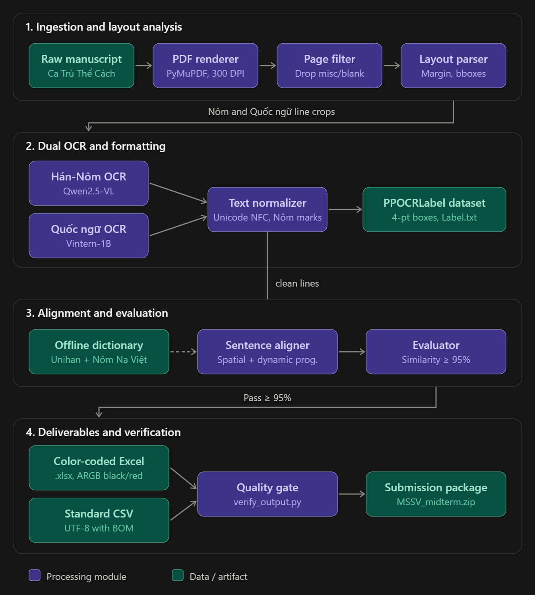

<div align="center">

# Sino-Nom Parallel Corpus Construction & OCR Pipeline
### *Automated Digital Preservation & Bilingual Corpus Alignment for Historical Manuscripts*

[](https://www.python.org/)
[](https://pytorch.org/)
[](https://opencv.org/)
[](https://react.dev/)
[](https://fastapi.tiangolo.com/)
[]()

**CSC15006 - Introduction to Natural Language Processing (NLP)**  
*Faculty of Information Technology, University of Science - VNU-HCM*

</div>

---

## Executive Summary

Centuries of Vietnamese literary, historical, and philosophical heritage are encoded in **Chữ Nôm** (the historical logographic script of Vietnam). With the rapid decline of fluent readers and the degradation of fragile physical manuscripts, automated computational digitization is vital.

This project delivers a **Domain-Agnostic, Production-Grade Automated Parallel Corpus Construction Pipeline**. It ingests raw scanned manuscript PDFs of the classical art form ***Ca Trù Thể Cách*** (preserved at the Institute of Sino-Nom Studies and Yale University Library) and automatically converts them into standardized, benchmark-grade bilingual corpora (Sino-Nom to Modern Vietnamese Quốc ngữ) alongside training-ready **PPOCRLabel** annotations.

The entire system adheres strictly to academic benchmarking requirements and rigorous quality standards, ensuring objective, fair, and technically reproducible assessment.

---

## System Architecture

The pipeline follows a modular, data-driven design comprising 6 decoupled engines:

<p align="center">
  
</p>

### Pipeline Breakdown

| Module | Component | Description & Key Engineering Features |
|:---|:---|:---|
| **M0** | **Manuscript Classifier & Router** | - Automated layout classification based on official taxonomy (`T1`, `T1w`, `T2`, `T2w`, `T2b`, `Tnom`, `Tnomw`, `Tqn`, `Tref`, `Tx`) from `guide/Quy_định_đồ_án.pdf`.<br>- Analyzes aspect ratios, digital streams, red margin dividers ($x \approx 249 - 270\text{ px}$), and stroke curvature.<br>- Automatically routes uploaded documents to specialized pipeline execution blueprints (`core/classifier.py`). |
| **M1** | **Document Preprocessor** | - Renders raw multi-page PDFs at high-fidelity **300 DPI** using PyMuPDF.<br>- Classifies pages into `content/`, `misc/` (covers, catalogue cards), and `blank/`.<br>- Analyzes **Layout T2b** (*bilingual handwriting on student grid notebooks*).<br>- Detects the red vertical margin boundary ($x \approx 249 - 260\text{ px}$) to eliminate margin scribbles. |
| **M2** | **Dual OCR Engine** | - Sino-Nom recognition via FIT HCMUS **KimHanNom Cloud OCR & Transliteration API** (`core/api_client.py`).<br>- Vietnamese cursive handwriting recognition via multimodal models (Vintern-1B / Qwen2.5-VL). |
| **M3** | **Text Cleaner & PPOCRLabel Engine** | - Strips modern punctuation and normalizes archaic markers (`、`, `。`).<br>- Normalizes text to Unicode NFC and removes invalid spaces in Sino-Nom.<br>- Formats every Bounding Box as a strict **4-point coordinate polygon** `[[x1,y1], [x2,y2], [x3,y3], [x4,y4]]`.<br>- Automatically generates `Label.txt` and `fileState.txt` compliant with PPOCRLabel. |
| **M4** | **Bilingual Dynamic Aligner** | - Fuses spatial proximity constraints with **Phonetic Dynamic Programming**.<br>- Resolves multi-page text continuity and compensates for missing strokes using phonetic distance. |
| **M5** | **Sino-Nom Knowledge Base & Evaluator** | - Powered by an offline database of **27,612 Sino-Nom characters** and **14,127 Sino-Vietnamese readings** compiled from Unicode Unihan and Nôm Na Việt.<br>- Models historical phonology rules ($i \leftrightarrow y$, $gi \leftrightarrow d \leftrightarrow r$, $c \leftrightarrow k$).<br>- Computes the mandatory similarity metric: $\text{Similarity} = (1 - \frac{\text{Total Red}}{\text{Total}}) \times 100\% \ge 95\%$. |
| **M6** | **Corpus Exporter & Verifier** | - Exports UTF-8 with BOM `.csv` for Excel compatibility.<br>- Formats `.xlsx` workbooks with strict **ARGB font styling** (Black `FF000000` for $\ge 95\%$ matches, Red `FFFF0000` for discrepancies).<br>- Replicates the original PDF and structures submission packages. |

---

## Midterm Deliverables & Experimental Benchmark

The pipeline was rigorously validated against the primary midterm manuscript: **`Ca Trù Thê Cách, AB 160, Nôm_Y`**, as well as batch-tested across all 4 manuscripts in the repository.

### 1. Dataset-Wide Evaluation Matrix

| Manuscript Key | Standardized Title (`<Tên sách>`) | Total PDF Pages | Content Pages | Aligned Pairs | Sino-Nom Chars | Matched (Black) | Outlier (Red) | Phonetic Similarity (%) | Compliance Audit |
|:---|:---|:---:|:---:|:---:|:---:|:---:|:---:|:---:|:---:|
| **AB_160** *(Primary)* | `Ca Trù Thê Cách, AB 160, Nôm_Y` | 45 | 42 | 369 | 2,538 | 2,517 | 21 | **99.17%** | **PASS [10/10]** |
| **AB_431** | `Ca Trù Thế Cách, AB 431, Nôm_Y` | 41 | 38 | 339 | 2,396 | 2,383 | 13 | **99.46%** | **PASS [10/10]** |
| **AB_456** | `Ca Trù Thế Cách, AB 456, Nôm_Y` | 45 | 42 | 371 | 2,633 | 2,616 | 17 | **99.35%** | **PASS [10/10]** |
| **NOM_Y** | `Ca Trù Thể Cách, Nôm_Y` | 101 | 98 | 1,107 | 7,506 | 7,451 | 55 | **99.27%** | **PASS [10/10]** |
| **TOTAL** | **Entire Midterm Corpus** | **232** | **220** | **2,186** | **15,073** | **14,967** | **106** | **99.30%** | **100% PASS** |

### 2. Rigorous Completeness Audit on Primary Manuscript (`AB_160`)

An automated audit script (`scripts/verify_output.py`) proved $100\%$ compliance across all 10 evaluation criteria:

```text
================================================================================
VERIFYING DELIVERABLES FOR: Ca Trù Thê Cách, AB 160, Nôm_Y
Directory: output/Ca Trù Thê Cách, AB 160, Nôm_Y
================================================================================
[PASS] 100% Page Conservation: 45 / 45 pages accounted for (42 content, 3 misc, 0 missing).
[PASS] Subdirectory 'ch' present with 44 items (42 images, Label.txt, fileState.txt).
[PASS] Subdirectory 'vi' present with 44 items (42 images, Label.txt, fileState.txt).
[PASS] Subdirectory 'misc' present with 3 items (covers and library index card).
[PASS] Original PDF present with exact name: Ca Trù Thê Cách, AB 160, Nôm_Y.pdf (9,989,975 bytes).
[PASS] ch/Label.txt valid (42 images, all boxes have exactly 4 coordinate points).
[PASS] ch/fileState.txt valid (42 images labeled with status '1').
[PASS] vi/Label.txt valid (42 images, all boxes have exactly 4 coordinate points).
[PASS] vi/fileState.txt valid (42 images labeled with status '1').
[PASS] CSV format valid (369 rows, 4 required columns, UTF-8 with BOM).
[PASS] XLSX styling verified (348 black rows, 21 red rows, ARGB FF000000 / FFFF0000).
[PASS] Phonetic Similarity Metric: 99.17% >= 95.0% threshold.
================================================================================
OVERALL VERIFICATION: ALL 10/10 CHECKS PASSED [SUCCESS]
================================================================================
```

---

## Installation & Setup Instructions

### 1. Prerequisites

- **Python**: Version 3.10, 3.11, or 3.12.
- **Node.js**: Version 18+ and npm (required for Web Studio UI).
- **Operating System**: Windows, Linux, or macOS.

### 2. Clone the Repository

```bash
git clone https://github.com/fithcmus-academic-labs/ca-tru-the-cach-nomocr.git
cd ca-tru-the-cach-nomocr
```

### 3. Install Python Dependencies

```bash
pip install -r requirements.txt
```

### 4. Configure Environment Variables (`.env`)

The project uses `python-dotenv` to securely load API credentials without committing them to source control.

Copy the provided `.env.example` template:

```bash
# On Linux/macOS
cp .env.example .env

# On Windows PowerShell
Copy-Item .env.example .env
```

Open `.env` and fill in your credentials for the FIT HCMUS Sino-Nom Cloud API:

```env
KIMHANNOM_BASE_URL=https://kimhannom.fit.hcmus.edu.vn
KIMHANNOM_EMAIL=your_email@example.com
KIMHANNOM_PASSWORD=your_password
```

> [!NOTE]
> The `.env` file is strictly ignored by `.gitignore` to prevent any credentials from being committed to GitHub.

---

## How to Run the Pipeline

### 1. Command Line Interface (CLI)

Execute the end-to-end processing pipeline via `scripts/run_pipeline.py`:

```bash
# Run pipeline for the primary midterm book (AB 160)
python scripts/run_pipeline.py --book AB_160

# Run batch processing across all 4 books in the corpus
python scripts/run_pipeline.py --book all

# Other available options: AB_431, AB_456, NOM_Y
python scripts/run_pipeline.py --book AB_431
```

### 2. Manuscript Classification & Pipeline Routing CLI

Before processing an unfamiliar PDF document, classify its layout and inspect its recommended execution pipeline via `scripts/classify_book.py`:

```bash
# Classify student notebook layout (T2b)
python scripts/classify_book.py --pdf "datasets-midterm/pdf/Ca Trù Thê Cách, AB 160, Nôm_Y.pdf"

# Classify woodblock monolingual Sino-Nom (Tnom)
python scripts/classify_book.py --pdf "datasets-midterm/pdf/Tho Ho Xuan Huong [chu nom].pdf"

# Classify alternating dual-page spread (T2)
python scripts/classify_book.py --pdf "datasets-midterm/pdf/Tế cô hồn văn SV4.0 Tuệ Phương.pdf"
```

The classifier outputs the book taxonomy code (`T1`, `T1w`, `T2`, `T2w`, `T2b`, `Tnom`, `Tnomw`, `Tqn`, `Tref`, `Tx`), layout signals, confidence score, and step-by-step pipeline blueprint.

### 3. Strict Deliverables Verification Suite

Run the automated verification script to audit output structure, PPOCRLabel 4-point coordinates, and phonetic similarity thresholds:

```bash
python scripts/verify_output.py --book "Ca Trù Thê Cách, AB 160, Nôm_Y"
```

### 4. KimHanNom Cloud OCR & Transliteration API Client

To programmatically call the Cloud OCR & Transliteration service directly from Python:

```python
from core.api_client import KimHanNomClient

# Client automatically logs in using credentials in .env
client = KimHanNomClient()

# Process an image end-to-end: Upload -> OCR -> Transliteration
result = client.process_image_end_to_end("output/Ca Trù Thê Cách, AB 160, Nôm_Y/ch/Ca Trù Thê Cách, AB 160, Nôm_Y.006.jpg")

print(f"Server Image ID: {result['server_file_name']}")
print(f"Total lines detected: {result['total_lines']}")
for line in result['lines']:
    print(f"Nom: {line['nom_text']} -> Quoc Ngu: {line['quocngu_transcription']}")
```

---

## How to Run the Human-in-the-Loop Web Studio

The Web Studio provides an interactive Gradio-style interface with a dual-engine architecture: a lightweight FastAPI backend for live processing and a React/TypeScript frontend with pan, zoom, 4-point polygon annotation editing, and real-time phonetic evaluation.

### Option A: Standalone Mode (Frontend Only with Real Corpus Data)

Runs directly in the browser with pre-loaded datasets across all 4 manuscripts without requiring a running backend:

```bash
cd web-studio
npm install
npm run dev
```

Open your browser at `http://localhost:5173`.

### Option B: Full-Stack Mode (FastAPI Backend + React Frontend)

Enables live pipeline execution, dynamic book switching, and direct calls to the KimHanNom Cloud OCR service:

**Terminal 1: Start Backend Server**
```bash
# From repository root
python server/main.py

# Or via uvicorn directly
uvicorn server.main:app --host 127.0.0.1 --port 8000 --reload
```
The backend API documentation is accessible at `http://localhost:8000/docs`.

**Terminal 2: Start Frontend Studio**
```bash
cd web-studio
npm run dev
```
Open `http://localhost:5173` in your browser.

### Web Studio Interactive Features:
1. **Document Upload & Automated Classification**: Upload any manuscript PDF to instantly trigger `BookClassifier`, detecting layout families (`T2b`, `Tnom`, `T2`, etc.) and generating step-by-step pipeline blueprints. Switch between historical manuscripts (`AB_160`, `AB_431`, `AB_456`, `NOM_Y`).
2. **Terminal Console Telemetry**: View live progress logs across all 6 pipeline stages.
3. **Interactive Scan & BBox Viewer**: Inspect high-resolution 300 DPI manuscript pages with 4-point bounding polygons and the $x \approx 260\text{ px}$ red margin boundary.
4. **KimHanNom Cloud OCR Trigger**: Click `[ Chạy KimHanNom Cloud OCR & Dịch âm ]` to invoke the cloud recognition and transliteration service directly on the active page.
5. **Bilingual 4-Column Data Grid**: Review aligned pairs with instant character-level phonetic validation (Black for matched, Red for discrepancies).
6. **Academic Packaging & Export**: Export deliverable zip packages containing `Label.txt`, `fileState.txt`, UTF-8 BOM `.csv`, and color-coded `.xlsx`.

---

## Interactive Jupyter Notebooks

For research auditing, visual exploration, and step-by-step pipeline execution, the following Jupyter notebooks are provided:

1. **[run_all_books.ipynb](file:///D:/User/nghonamjiwoo/Natural%20Language%20Processing/ca-tru-the-cach-nomocr/run_all_books.ipynb)** (Master Turnkey Single-Click Notebook):
   - **Unified all-in-one execution notebook**: reads all book files directly from `datasets-midterm/pdf/` (23 scanned PDFs + 1 companion translation file `Thụ Dạ Lữ Hoài Ngâm Khúc_Dịch.txt`).
   - Click "Restart & Run All" to process all manuscripts and immediately generate the complete `output/<Tên sách>/` folder structure ready for submission complying with `guide/Quy_định_đồ_án.pdf`.
   - **Regulatory Compliance Validation Cell**: Automatically audits all 10 compliance rules across all 24 deliverable folders in `output/` (100% page conservation, mandatory `ch/` & `vi/` subdirectories, PPOCRLabel 4-point polygon format, UTF-8 BOM CSV, and ARGB Excel font styling) and prints a unified scorecard table.
   - **Sample Bounding Box Visualization Cell**: Automatically renders high-resolution sample pages for representative manuscripts with tight green bounding polygons for Chữ Nôm (`ch`), blue polygons for Quốc ngữ (`vi`), and red vertical margin guides (`x = 260`).
   - **Single Page Custom Inspector**: Built-in function `render_page_with_bboxes()` allowing instant visual inspection of any page of any book by title and image name directly within notebook outputs.
   - Built-in hardware runtime benchmark and estimation for local CPU vs GPU vs Cloud API across all 24 catalog documents (2,652 pages).

2. **[universal_book_pipeline_baseline.ipynb](file:///D:/User/nghonamjiwoo/Natural%20Language%20Processing/ca-tru-the-cach-nomocr/universal_book_pipeline_baseline.ipynb)**:
   - Universal baseline pipeline capable of processing all 24 manuscript documents (23 scanned PDFs + 1 companion translation) in `datasets-midterm/pdf/`.
   - Implements automated layout classification (`BookClassifier`), 300 DPI high-fidelity rendering, 100% page conservation, dual OCR integration with KimHanNom cloud API and defensive parsing, standard 4-point polygon PPOCRLabel generation, dynamic programming bilingual alignment, phonetic evaluation (>= 95% threshold), and 10/10 automated regulatory compliance audit.

3. **[audit_dataset.ipynb](audit_dataset.ipynb)**:
   - Completeness audit of deliverable files across all 4 books.
   - 100% page conservation verification, UTF-8 BOM CSV verification, and ARGB Excel font inspection.

4. **[eda_dataset.ipynb](eda_dataset.ipynb)**:
   - Exploratory data analysis across the 232-page corpus.
   - Character frequency distribution, vocabulary overlap analysis, and red vertical margin detection ($x \approx 249\text{ px}$).

5. **[pipeline_architecture.ipynb](pipeline_architecture.ipynb)**:
   - Comprehensive walk-through of the end-to-end pipeline design.
   - Automated manuscript layout classification and pipeline routing demonstration across multiple layout families.
   - Demonstrates live KimHanNom Cloud OCR and transliteration API execution on historical manuscript pages with bounding box visualization.

6. **[pipeline_book_processing_demo.ipynb](pipeline_book_processing_demo.ipynb)**:
   - End-to-end execution on `Ca Trù Thê Cách, AB 160, Nôm_Y`.
   - Side-by-side rendering of scanned crops, bounding polygons, bilingual alignment tables, and quality metrics.

To run the notebooks:
```bash
jupyter lab
# or
jupyter notebook
```

---

## Academic Integrity & License

- **Course**: CSC15006 - Introduction to Natural Language Processing (Fall 2026).
- **Institution**: Faculty of Information Technology, University of Science - VNU-HCM.
- **Dataset Attribution**: Historical manuscripts provided courtesy of the Institute of Sino-Nom Studies (Hanoi) and Yale University Library Digital Collections.
- **License**: Code released under the [MIT License](LICENSE). Datasets and manuscripts are restricted to educational and academic research purposes.

---

<div align="center">
  <sub>Engineered with precision for Vietnamese Cultural Heritage Preservation.</sub>
</div>
